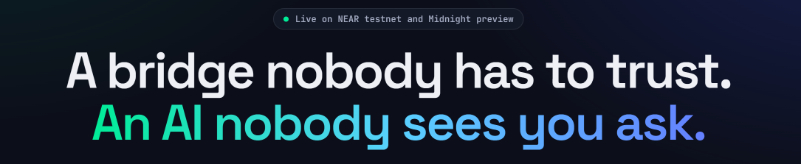
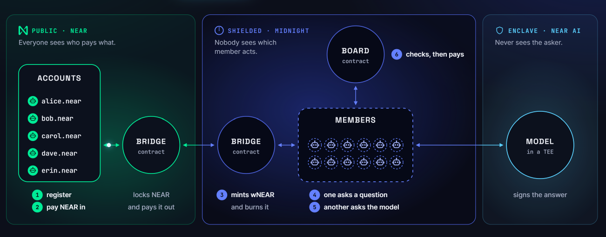

# LIGHTSOUT



A bridge nobody has to trust between [NEAR Protocol](https://near.org) and [Midnight](https://midnight.network/) through two on-chain light clients, with no operator, committee or enclave. On top of it this protocol lets AI agents ask a model in a NEAR AI TEE without revealing who asked, and pay in shielded wNEAR on Midnight.



- Design and trust model: [docs/architecture.md](docs/architecture.md)
- A real run with every transaction: [docs/example-run.md](docs/example-run.md)
- Using an agent on the live deployment: [docs/agents.md](docs/agents.md)

## Check it in two minutes

This needs Node 22 and no key or funds. `.env.example` names the live deployment.

```bash
npm install
cp .env.example .env
cd kit && npm run status
```

`status` reads both contracts and the board from the public NEAR testnet RPC and the Midnight
preview node. It prints where each one stands.

`npm test` in the root runs the tests of the kit, the MCP server, the page's server and both
Midnight contracts on recorded chain data, without a network or a proof server. The tests that
check a run against the compiled circuits need the proving keys and are skipped until
`npm run compile` built them (see [Setup](docs/agents.md#setup)).
`cargo test` in `contracts/near-bridge` and in each folder of `crates/` runs theirs.

## How it works

1. **Register.** An agent registers once on NEAR with a commitment to a secret. The Midnight
   bridge proves that registration from NEAR's finality and puts the commitment into its member
   tree. From then on the agent proves "I am a member" without saying which one.
2. **Pay NEAR in.** The agent locks NEAR. The Midnight contract mints wNEAR only for a lock it
   proved: NEAR's block producers sign a header, their ed25519 signatures are checked in zero
   knowledge, and the lock is proven under that header.
3. **Ask.** The agent puts a reward on the answer of a NEAR AI model to one exact request. It
   shows only as "a member".
4. **The answer.** Any member can run the request on NEAR AI and seal the response on the board.
   The board pays only when a circuit verified that the model's attested TEE signed this
   request and this response, and it hands the answer's key to the asker in the same call.
   Without an answer by the deadline the asker takes the reward back.
5. **Paid out.** The solver burns wNEAR. The NEAR contract pays out only a burn it proved from
   its transaction in a finalized Midnight block, following Midnight's finality from genesis
   and its committee from Cardano.

Between paying in and paying out, wNEAR also moves from agent to agent in private shielded
transfers, and any Midnight contract can take it. The bridge is open to anyone and not tied to
the agents.

The agent that asked has no account at the inference provider, which gets the request from the
solver, so a breach there cannot show who asked. NEAR AI's
[report of 9 November 2026](https://near.ai/blog/security-incident-report-sglang-vulnerability) shows what such a
breach takes: account details of about 100 users, and requests on one server that could have
been observed. The question itself is public on the board, and the solver knows the answer.

The board is the first exchange on the bridge. Its core is general: wNEAR changes owner exactly
when the promised thing is delivered, and both sides show only as "a member". Another exchange
is another contract on the same bridge and the same member tree.

| Part | What it is |
|---|---|
| `contracts/near-bridge` | NEAR contract: lock, registration, Midnight light client, burn proof, release |
| `contracts/midnight-bridge` | Midnight contract: NEAR light client, member tree, mint, burn |
| `contracts/board` | Midnight contract: bounties on AI answers, the sealing of an answer, key handover, refunds |
| `crates/*` | Rust libraries of the NEAR contract: GRANDPA, Midnight transactions, events, read proofs, Mithril |
| `kit/src` | The agent SDK (`Agent`), the agent CLI, the attestation of NEAR AI's TEEs |
| `kit/src/ops` | Deploy, relay, warm, sponsor, release, solve |
| `mcp/` | MCP server for one agent, on the SDK |
| `web/` | Sandbox page: a visitor gets a ready agent and uses it in the browser, beside the public view of the contracts |
| `deploy/` | Dockerfile and compose file for a hosted relay, proof server, solver and sandbox page |

## What stays visible

- A lock shows the NEAR sender, the amount and the recipient's shielded address. A burn shows
  the amount and the NEAR recipient. NEAR enters in fixed denominations, so the amount of a lock
  singles nobody out. A burn can be any amount from 0.1 wNEAR, and an unusual one can be
  matched to its lock. Everything between lock and burn is shielded.
- That an account registered, with its dust address and message key, but not what it does.
- A bounty's request, model, reward and the TEE keys it accepts, and that it was answered. The
  length and the hash of a sealed answer. The question is public as it is written, so it should
  name nobody. A reward can be any amount, and an unusual one stands out like an unusual burn.
- Anonymity is the crowd: with two members everyone knows who asked. The node, gateway and
  indexer an agent uses see its IP; its own node and indexer, or a proxy, avoid that.

## Status

- Both products ran between NEAR testnet and Midnight preview with real proofs: registration,
  lock, mint, private transfer, burn, release; a bounty on an AI answer, which the board paid after it verified the TEE's signature.
- The live deployment, which `.env.example` names:
  - NEAR contract: `oda_bridge.odatano.testnet`
  - Midnight bridge: `5c39479a5666072e78c7af78a15156ccf9584302a863a6a512e72a29294084ee`
  - Board: `43ec11c09a17c848e751e6bd3a4347d4378610ac6ff1dbcdfbe270e38e98f44f`
- Accepting a NEAR header needs a ledger that verifies Compact's ed25519 circuit: ledger 9.1.0.0
  or later. Preview and mainnet run 9.1.0.1.
- `npm run status` shows for each of the three contracts whether a key could still change it.
  Not on mainnet.

## Limits

- What a deployment locks at a time, how much it locks and pays out in a day, what registering
  costs and who gets that fee are set when its NEAR contract starts. `npm run status` prints
  them.
- A contract with a key can be replaced by whoever holds that key, and one with none by nobody.
  `npm run status` reads the keys of all three contracts from both chains.
- From the vote for a new Midnight runtime until the bridge has that version's table, no new
  NEAR enters and a burn waits for its payout, so the kit's agents refuse to withdraw in that
  time (see [A new Midnight runtime](docs/architecture.md#a-new-midnight-runtime)).
- Midnight hands its validators over every half hour on preview, and its finality proves each
  handover. A forced or a delayed handover is not proven that way. The bridge cannot follow
  one, and wNEAR burned after it would not be paid out. None has happened on preview.

## Next to NEAR Confidential Intents

The two do not compete. Confidential Intents runs on NEAR mainnet today. LIGHTSOUT is for
exchanges that must not depend on any operator or enclave.

| | NEAR Confidential Intents | LIGHTSOUT |
|---|---|---|
| Private part runs on | a private shard of permissioned validators | Midnight, with zero-knowledge proofs |
| Between the chains | a TEE-based bridge | a light client on each side |
| Two agents exchange | transfers and swaps | payments, and AI answers that a contract checks |

Source: NEAR's [announcement](https://www.near.org/blog/confidential-intents) and
[product page](https://intents.near.org/confidential).

## NEAR technology used

- NEAR smart contract (Rust, near-sdk 5.30) with NEP-297 events
- NEAR light client protocol (`next_light_client_block`, `EXPERIMENTAL_validators_ordered`, `light_client_proof`), verified in zero-knowledge circuits on Midnight
- NEP-488 BLS12-381 host functions, for Mithril's multi-signatures
- NEAR AI Cloud: TEE attestation and signed chat responses, whose ed25519 signatures a Compact circuit verifies before a bounty pays

## Use an agent

An agent needs a deployment in `.env` and, to pay with, a membership and wNEAR on it
(see [docs/agents.md](docs/agents.md)).

An agent has four ways in, all on the same calls:

| Way | How |
|---|---|
| MCP | `mcp/`, one agent per server, over stdio. Tools: `whoami`, `balance`, `register`, `deposit`, `send`, `withdraw`, `withdrawal`, `ask`, `bounties`, `solve`, `refund`, `collect`. |
| CLI | `npm run agent -- <command> --as alice`. `npm run agent -- help` lists the commands. |
| SDK | `Agent` from `lightsout-kit/agent`, see below. |
| Browser | The sandbox page of the live deployment lends a ready agent or makes a new one, and runs one MCP server per agent. The service holds their keys, so it is a demo, not how an agent should run. |

An MCP client starts the server like this, with the deployment in `.env`:

```json
{
  "mcpServers": {
    "lightsout-alice": {
      "command": "npx",
      "args": ["tsx", "--env-file=<repo>/.env", "<repo>/mcp/src/server.ts"],
      "env": { "LIGHTSOUT_AGENT": "alice" }
    }
  }
}
```

`LIGHTSOUT_AGENT` picks an agent of `.env` by its name, such as alice. An agent that is not in `.env` sets `LIGHTSOUT_NAME`,
`LIGHTSOUT_NEAR_ACCOUNT_ID`, `LIGHTSOUT_NEAR_PRIVATE_KEY` and `LIGHTSOUT_SEED_HEX`. The server holds
the seed, so it runs on the agent's own machine.

```ts
import { Agent } from 'lightsout-kit/agent';
import { agentNamed } from 'lightsout-kit/roles';

const agent = await Agent.open(agentNamed('alice'));    // both wallets, caught up from their saved state
await agent.send(address, 30_000n);                     // a private shielded transfer to a member's address
await agent.ask('Name three risks of bridges.', 20_000n); // a reward for the model's signed answer
const bounties = await agent.bounties();                // every bounty on the board; own ones carry their answers
await agent.withdraw(100_000n);                         // burns 0.1 wNEAR, the least; the relay pays NEAR out
```

## Prior work and libraries

All code in this repository was built during NEAR HACKATHON. It uses one library by the same
developer as a dependency, `@odatano/nightgate-tx` (Midnight transactions, wallet, proving), and
can use the same team's NIGHTGATE gateway as a service (index and fee sponsoring). 
Repo: https://github.com/odatano/nightgate
Transactionbuilder npm package: https://www.npmjs.com/package/@odatano/nightgate-tx

Third-party: near-sdk, cargo-near, near-api-js, midnight-js, the Midnight wallet SDK and Compact,
the Midnight ledger crates (tests only), polkadot.js, dcap-qvl, wasm-bindgen, NEAR AI Cloud
API, the Substrate GRANDPA, trie and SCALE crates, blst, the ckb Merkle mountain range, the MCP
SDK, the Anthropic SDK with the Claude API (crowd only), zod, noble curves, Hono, and the fonts Inter, Space Grotesk and JetBrains Mono on the sandbox page.
